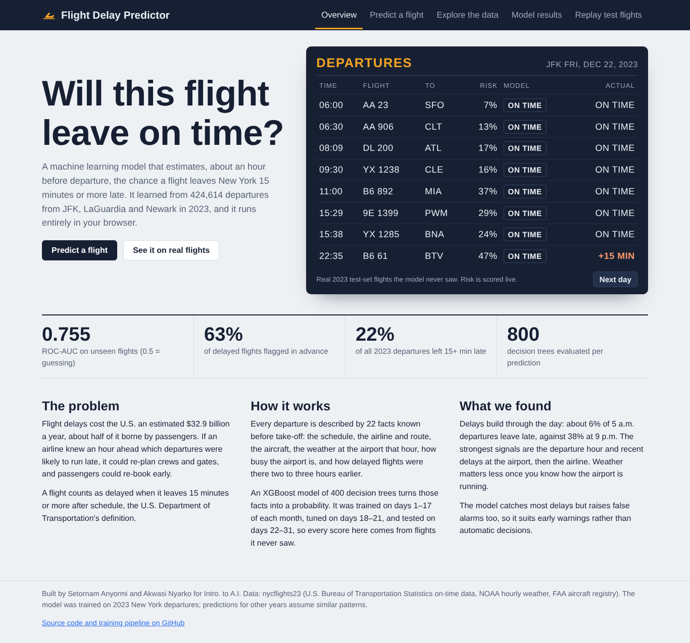

# Flight Delay Prediction

Predicts whether a flight leaving New York will depart **15 minutes or more late**, the U.S. Department of
Transportation's definition of a delay, using only information known about an hour before departure.

**Live dashboard:** https://akwasinyarko.github.io/Flight_Delay_Prediction/

The dashboard runs the trained XGBoost model directly in the browser. There's no server and nothing to install.



Built by Setornam Anyormi and Akwasi Nyarko for Intro. to A.I.

## Results

Real 2023 data: all 424,614 departures from JFK, LGA and EWR. Scored on 129,802 test flights (days 22–31 of
every month) that no model saw during training or tuning.

| Model | Accuracy | Precision | Recall | F1 | ROC-AUC |
| --- | ---: | ---: | ---: | ---: | ---: |
| Baseline (always "on time") | 0.778 | – | 0.000 | 0.000 | 0.500 |
| Logistic Regression | 0.714 | 0.405 | 0.616 | 0.488 | 0.740 |
| Random Forest | 0.726 | 0.420 | 0.622 | 0.501 | 0.755 |
| **XGBoost (deployed)** | **0.723** | **0.417** | **0.626** | **0.501** | **0.755** |
| XGBoost, schedule + weather only | 0.673 | 0.369 | 0.665 | 0.475 | 0.732 |

- The baseline has the highest accuracy and catches no delays, which is why we judge on F1 and ROC-AUC.
- Random Forest and XGBoost tie. XGBoost is deployed because its trees export cleanly to the browser.
- Recent delays at the airport (removed in the last row) add 0.023 AUC. Tuning XGBoost over six settings on the
  validation days added only 0.002 (`reports/xgb_tuning.csv`).
- The strongest signals are the airline, the departure hour and recent airport delays
  (permutation importance, `reports/figures/04_feature_importance.png`).
- The project was first built on 2013 data (`reports/archive_2013/`), where XGBoost reached AUC 0.765 and departure
  hour was the strongest signal. On 2023 data the airline matters most, so the model should be retrained yearly.

## The dashboard

| Tab | What it does |
| --- | --- |
| Overview | A departures board of real test flights: the model's live risk next to what actually happened |
| Predict a flight | Pick a route, airline, date, time, weather and airport conditions; see the delay probability, risk by hour and what-if comparisons |
| Explore the data | Delay rates by hour, month, weekday, visibility, precipitation and airline, filterable by airport and airline |
| Model results | Metrics table, ROC curves, confusion matrix, permutation feature importance |
| Replay test flights | 2,000 test flights, searchable and filterable by result (delay caught, false alarm, and so on) |

## How it works

1. **Data** (`data/`): every 2023 domestic departure from JFK, LGA and EWR ([nycflights23](https://github.com/moderndive/nycflights23):
   U.S. BTS on-time data, NOAA hourly weather, FAA aircraft registry; CC0). `scripts/get_data.py` rebuilds the CSVs.
   The 10,738 cancelled flights are excluded.
2. **Features** (`flight_delay/features.py`): 22 inputs known before departure. They cover the schedule (hour, weekday, month,
   days to a holiday), the flight (airline, destination, distance, aircraft age and seats), the weather at the origin
   that hour, airport congestion, and the average delay of flights scheduled 2–3 hours earlier at the same airport.
3. **Split** (time-based, inside every month): train on days 1–17, tune the decision threshold on days 18–21, and
   test on days 22–31. Every season is in training, and every test flight comes after its training data.
4. **Models** (`flight_delay/models.py`): Logistic Regression, Random Forest and XGBoost (800 trees, depth 5, chosen
   by `scripts/tune_xgboost.py` on validation AUC), with class weighting for the 22% delay rate and an F1-tuned threshold.
5. **Export** (`flight_delay/export.py`): writes the XGBoost trees and small summary files to `docs/data/`.
   `docs/js/model.js` re-implements the preprocessing and tree evaluation in JavaScript. On 1,000 test flights it
   matches Python to within 0.0000005 (the test fails above 0.0001).

## Run it yourself

```bash
pip install -r requirements.txt
python -m flight_delay.train            # about 2 minutes: trains, evaluates, writes figures and dashboard data
python scripts/slide_figures.py         # presentation charts -> reports/slides/
python -m http.server --directory docs  # then open http://localhost:8000
```

Run the tests (feature checks, JavaScript-vs-Python parity, headless-browser dashboard test):

```bash
python -m playwright install chromium   # once
python -m pytest
```

## Publishing on GitHub Pages

In the repository, open **Settings → Pages**. Under **Build and deployment**, choose **Deploy from a branch**, then
the **main** branch and the **/docs** folder, and click **Save**. The site appears at the link above within a minute
or two. After retraining, commit the updated `docs/data/` folder to refresh the live site.

## Repository layout

```
data/                 2023 CSVs (flights zipped), rebuilt by scripts/get_data.py
scripts/              get_data.py, tune_xgboost.py, slide_figures.py
flight_delay/         Python package: config, data, features, models, charts, export, train
tests/                pytest suite + parity.js (Node runner for the browser model)
docs/                 the GitHub Pages site (index.html, css/, js/, data/, vendor/Chart.js)
docs/superpowers/specs/  design spec for this project
reports/              figures, model_results.csv, xgb_tuning.csv, slide charts, screenshots, archive_2013/
```

## Limitations

- One year (2023) and three airports. Patterns drift between years (see the 2013 comparison above).
- Weather is measured at the departure airport only, not along the route or at the destination.
- About 25% of flights that leave on time still get a delay warning (false alarms); when the model warns, it is
  right 42% of the time. It suits early warnings, not automatic decisions.
- In the predictor, unset inputs use the typical 2023 value for that airport, hour and month.

## Sources

- Ball, M., et al. (2010). *Total Delay Impact Study*. NEXTOR, for the FAA.
- Rebollo, J. J., & Balakrishnan, H. (2014). Characterization and prediction of air traffic delays. *Transportation Research Part C*, 44, 231–241. doi:10.1016/j.trc.2014.04.007
- Carvalho, L., Sternberg, A., et al. (2020). On the relevance of data science for flight delay research: a systematic review. *Transport Reviews*. doi:10.1080/01441647.2020.1861123
- Yazdi, M. F., Kamel, S. R., Chabok, S. J. M., & Kheirabadi, M. (2020). Flight delay prediction based on deep learning and Levenberg-Marquart algorithm. *Journal of Big Data*, 7. doi:10.1186/s40537-020-00380-z
- Kiliç, K., & Sallan, J. M. (2023). Study of delay prediction in the US airport network. *Aerospace*, 10(4), 342.
- Giusti, L., Carvalho, L., Gomes, A. T., Coutinho, R., Soares, J., & Ogasawara, E. Analyzing flight delay prediction under concept drift. arXiv:2104.01720.
- Ismay, C., Couch, S. P., & Wickham, H. *nycflights23: Flights and Other Useful Metadata for NYC Outbound Flights in 2023*. R package v0.2.0.
- U.S. Bureau of Transportation Statistics. Airline On-Time Performance Data. https://www.transtats.bts.gov
- Breiman, L. (2001). Random forests. *Machine Learning*, 45, 5–32. doi:10.1023/A:1010933404324
- Chen, T., & Guestrin, C. (2016). XGBoost: a scalable tree boosting system. *Proc. KDD ’16*. arXiv:1603.02754
- Pedregosa, F., et al. (2011). Scikit-learn: machine learning in Python. *JMLR*, 12, 2825–2830.
- Chart.js 4.4.1 (MIT), bundled in `docs/vendor/`.
